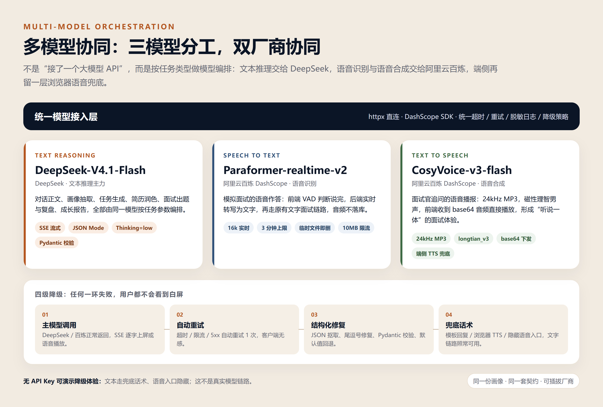
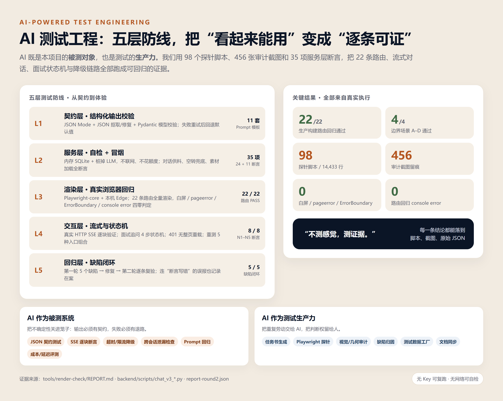
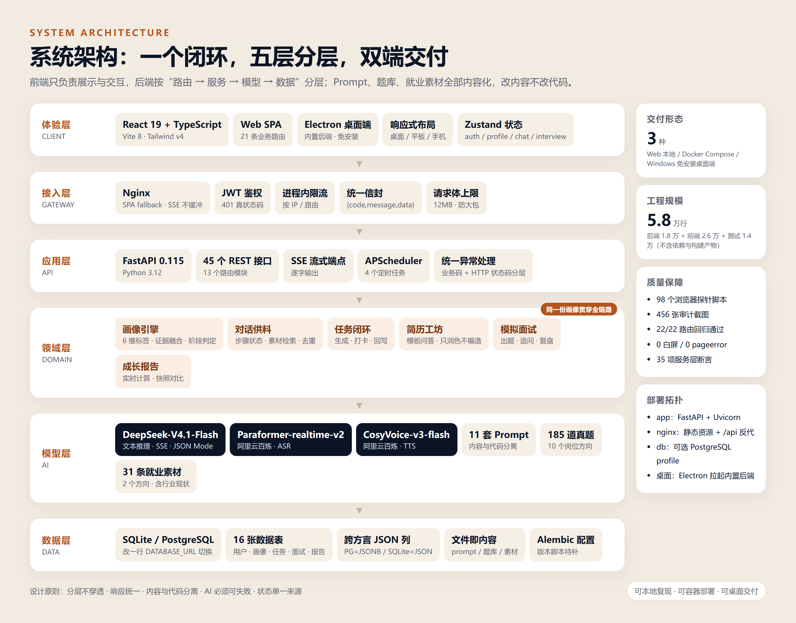
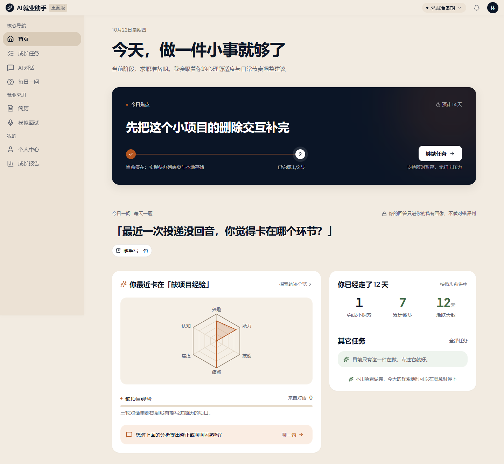
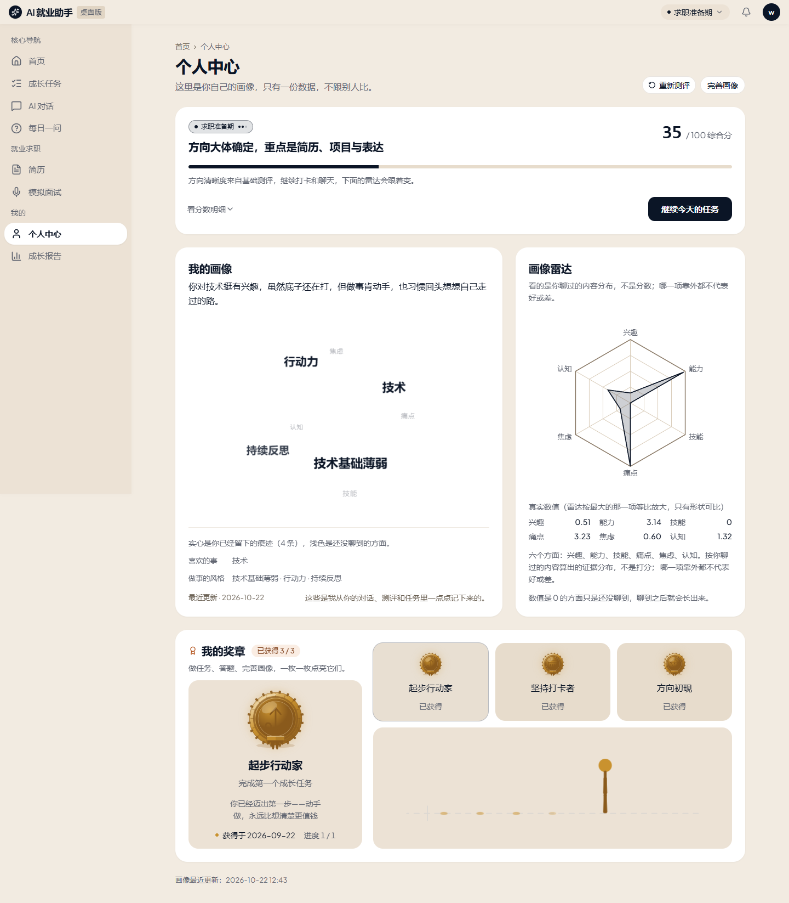
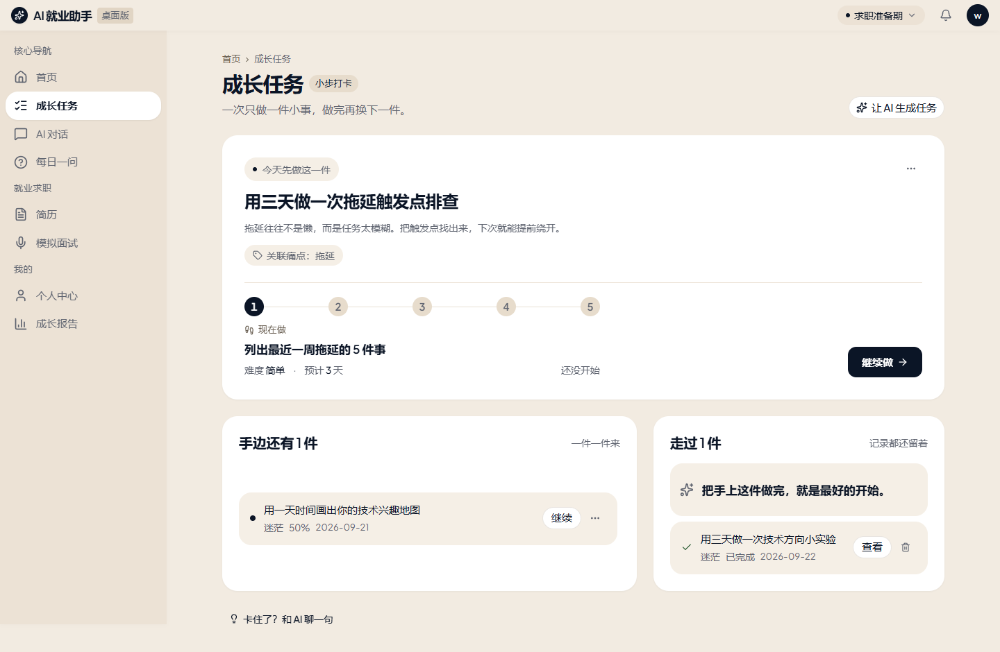
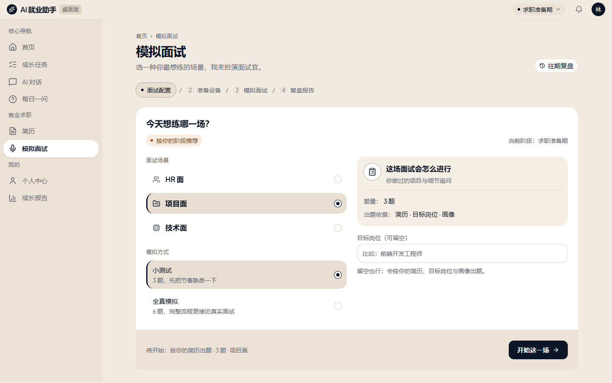

# AI 就业小助手

::c-title:: 面向高校学生的 AI 求职准备与行动闭环系统

::c:: 项目介绍文档（参赛版）

::c:: 一次测评建立画像，AI 在对话、任务、简历、面试与报告中持续更新画像，把「我该做什么」收敛成「今天做这一件」。

::c:: 参赛团队：WYHAND（个人参赛）

::c:: 指导教师：无（学生独立项目）

::c:: 项目方向：AI 应用创新 · 多模型协同 · AI 测试工程

::c:: 2026 年 10 月

## 摘要

**一句话：** 一个会记住你、陪你练、逼你动手的 AI 就业搭子——用一份持续更新的画像，把“我该做什么”收敛成“今天做这一件”。

**问题：** 高校就业指导是一对多，测评报告看完就忘，简历和面试缺少反馈。学生缺的不是信息，而是在正确阶段做对下一件事。

**方案：** 30 题测评建立初始画像 → AI 对话补充证据 → 生成可打卡的成长任务 → 打卡回写画像 → 简历与模拟面试 → 成长报告。测评、对话、任务、简历、面试、报告读取同一份画像，不存在“各页各说一套”。

**三个创新点：**

1. **证据链画像**：每条标签都有来源、权重、原始证据与更新时间；建议必须引用画像，不是通用鸡汤；
2. **意图控制 + AI 协同**：识别“拒绝 / 情绪 / 卡住 / 提问 / 目标”五类意图，只控制边界、进度与供料，把措辞自由留给模型；文本、ASR、TTS 三模型分工，双厂商协同，四级降级；
3. **把 AI 关进工程闭环**：11 套 Prompt 契约、SSE 真流式、幂等、超时降级、结构化校验，配合 98 个探针脚本、456 张审计截图、35 项服务层断言。

**当前证据：** 22/22 路由回归、4/4 边界场景、8/8 专项断言、0 白屏 / 0 pageerror / 0 ErrorBoundary；5 个第一轮缺陷全部修复并复验。**边界：** 这是工程与体验证据，不等同于大规模用户效果验证；用户调研、AI 输出质量评测与校园试点已列入落地计划。

| 评审关注 | 本文回答 | 对应章节 |
|---|---|---|
| 问题是否真实 | 一对多就业指导、测评看完就忘、简历面试缺反馈 | 1.2 / 1.8 |
| 方案是否有创新 | 证据链画像、意图控制、AI 协同、闭环回写 | 2.1—2.6 |
| 技术是否可信 | 分层架构、SSE、结构化输出、多模型降级 | 第四章 |
| 效果是否可证 | 22/22 路由、35 项断言、5 个缺陷闭环、演示案例 | 3.4 / 3.5 / 3.9 |
| 能否落地 | 三种交付形态、校园试点路径、成本与合规 | 1.5 / 7.6 / 4.11 |

## 一、项目详情及使用方式

### 1.1 项目是什么

AI 就业小助手是一套面向大一至大四学生的**求职准备与行动闭环系统**。它不是“再做一个聊天机器人”，而是把高校就业指导拆成一条可执行、可回写、可验证的闭环：

**结构化测评 → 初始画像 → AI 职业对话 → 成长任务 → 打卡回写 → 简历生成 → 模拟面试 → 成长报告**

系统只回答一个问题：**这个学生现在最该做的下一件事是什么？** 答案不是一段通用鸡汤，而是一个带步骤、带时长、带完成标准的成长任务；做完之后，画像会变，下一次建议也会变。

在技术形态上，它还是一个典型的**多模型 AI 协同项目**：DeepSeek 负责文本推理，阿里云百炼负责语音识别与语音合成，浏览器语音作为端侧兜底；三模型分工、双厂商协同，再叠加统一的失败降级策略。我们不满足于“Demo 能跑”，而是要求每一条建议都有画像依据、每一次生成都有契约、每一条链路都有测试证据。

| 项目名片 | 内容 |
|---|---|
| 项目名称 | AI 就业小助手（AI Career Companion） |
| 一句话定位 | 会记住你、陪你练、逼你动手的 AI 就业搭子 |
| 目标用户 | 大一至大四、方向未定或求职准备不足的高校学生 |
| 核心能力 | 画像、对话、任务、简历、面试、报告六位一体 |
| 技术形态 | React SPA + FastAPI + 多模型协同 + Electron 桌面端 |
| 交付形态 | Web 本地运行、Docker Compose、Windows 免安装桌面端 |
| 开源仓库 | https://github.com/WYHAND/AAAHMXZS |
| 项目周期 | 2026 年 9 月—10 月，三个大版本持续迭代 |

### 1.2 为什么做它

高校就业指导的现实是“一对多”：一次讲座覆盖几百人，测评报告看完就忘，简历和面试得不到及时反馈。学生真正缺的不是信息，而是**在正确阶段做对下一件事**。

我们把问题拆成三个具体缺口：

- **不知道自己是谁**：做过测评，但结果是一张看完就忘的雷达图，无法指导行动；
- **知道问题却不行动**：知道“缺项目经验”，但不知道今天该做什么、做多久、做到什么程度；
- **练了没人反馈**：简历没人改，面试没人陪，错了也不知道错在哪。

项目的解法是：**先画像，再建议；把建议变成动作；让动作反过来更新画像。** 三条原则贯穿所有页面，所有 AI 输出都必须引用当前画像与真实证据，不允许“各页各说一套”。

### 1.3 核心闭环

1. **测**：30 题四维度测评，3 分钟生成初始画像与阶段判断；
2. **画**：画像沉淀为六维标签（兴趣、能力、技能、痛点、焦虑、认知），每条标签带来源与证据；
3. **聊**：AI 职业指导对话，结合画像、任务、简历与就业素材，逐字流式输出；
4. **练**：AI 把建议拆成成长任务，每个任务含 3—6 个可打卡步骤；
5. **评**：简历只润色不编造，模拟面试出题、追问、复盘，成长报告实时计算；
6. **回**：打卡、对话、面试、每日一问都会把新证据回写画像，驱动下一轮建议。

### 1.4 功能地图

| 模块 | 用户看到什么 | AI 在里面做什么 |
|---|---|---|
| 登录 / 注册 | JWT 登录、登录态持久化、已登录自动分流 | 无 |
| 职业测评 | 30 题四维度选择题、进度与离开保护、重测入口 | 题目映射标签、生成初始画像与阶段 |
| 首页 | 阶段判断、今日焦点任务、今日一问、AI 发现、成长节律 | 聚合画像与任务，决定“下一步做什么” |
| AI 对话 | 逐字流式回复、多轮上下文、历史会话、结论卡片 | 画像注入、素材供料、跨会话记忆、标签抽取 |
| 成长任务 | 任务列表、步骤详情、打卡、放弃、删除 | 按痛点生成任务与步骤、打卡后回写画像 |
| 个人画像 | 六维雷达、标签球、阶段徽章、人物速写 | 标签融合、证据排序、画像摘要生成 |
| 每日一问 | 每天一道轻量问题、历史回顾、记录节奏 | 出题、反馈、累计 7 题触发画像微调 |
| 我的简历 | 问答式逐字段填写、AI 润色、打印样式 | 只改写用户写下的内容，数字与空白字段强校验 |
| 模拟面试 | 岗位与场景选择、文字/语音作答、追问、复盘评分 | 真题检索、贴合简历改写、2 轮追问、复盘 |
| 成长报告 | 阶段总结、能力变化、与上次快照对比、下一步建议 | 实时计算、建议生成、报告 → 任务闭环 |
| 奖章 | 起步行动家、坚持打卡者、方向初现 | 基于真实行为证据即时结算 |

### 1.5 怎么使用

三种形态共用同一套前后端代码：

- **本地 Web**：Python 3.12 + Node 20.19；后端 `uvicorn app.main:app`，前端 `npm run dev`，首次执行 `python -m app.db.init_db` 建表。完整命令见 README，10 分钟可复现；
- **Docker**：构建前端后 `docker compose up -d`；需要 PostgreSQL 时加 `--profile postgres`，改一行 `DATABASE_URL` 即可切换；
- **Windows 桌面端**：拷贝 `electron/release/win-unpacked`，双击 `AI就业助手.exe`，内置 FastAPI 后端与 SQLite，数据跟着文件夹走，备份就是拷走一个文件。

> **降级说明：** 没有 API Key 时，系统进入降级演示——文本链路使用兜底话术、语音入口隐藏，页面不会白屏。这能保证演示不中断，但**不等于真实模型效果**；答辩时我们会明确区分“真实模型响应”与“离线兜底”。

### 1.6 评委 3 分钟演示脚本（使用预置账号）

演示不现场做 30 题测评，直接用已完成测评的预置账号，把时间留给“问题 → 行动 → 变化”：

1. **系统怎么识别问题**：首页展示画像、AI 发现与今日焦点，说明“缺项目经验”这条结论来自哪次对话、哪条证据；
2. **系统怎么给出行动**：打开今日任务，展示 3—5 个可打卡步骤、预计时长与完成标准；
3. **行动后有什么变化**：完成一步打卡，回到画像看标签/分数变化；打开成长报告，展示“下一步”建议如何随证据变化。

语音面试、简历润色作为备用演示，不计入 3 分钟主线。

### 1.7 项目规模

| 维度 | 数据 |
|---|---|
| 后端代码 | 94 个 Python 文件，约 1.8 万行 |
| 前端代码 | 137 个 TS/TSX 文件，约 2.6 万行 |
| 测试脚本 | 98 个浏览器探针脚本，约 1.4 万行 |
| API | 45 个 REST 接口，13 个路由模块 |
| 数据表 | 16 张（用户、画像、测评、对话、任务、简历、面试、报告、奖章等） |
| 内容资产 | 11 套 Prompt、185 道岗位真题（10 个方向）、31 条就业素材 |
| 前端路由 | 21 条业务路由 + 404 兜底 |
| 过程留痕 | 456 张审计截图、56 张逐路由截图、完整决策记录 |

### 1.8 需求侧证据：现在有什么、还缺什么

我们不把“痛点”当成已证实的结论，而是分成三层说明：

- **已有事实**：高校就业指导普遍一对多、测评报告缺少后续动作、简历与面试反馈不及时；这些是产品设计的起点；
- **已有走查**：项目内多组演示数据完整走通了“测评 → 画像 → 对话 → 任务 → 打卡 → 报告”，验证了流程成立，但**不是大规模用户统计**；
- **尚缺证据**：学生问卷、就业老师访谈、7 日留存、建议采纳率、简历润色前后的人工评估。

下一步在校园试点中补三组数据：100+ 份学生问卷、10 名用户访谈、8 周留存与任务完成率。**在那之前，本文所有效果描述都限定为“流程与工程证据”，不冒充用户效果结论。**

## 二、项目亮点

### 2.1 画像不是标签墙，而是可追溯的证据链

很多产品的“用户画像”是一组拍脑袋的标签。本项目的每条标签都必须回答三个问题：**从哪来、证据是什么、什么时候更新的**。

- 六个维度：兴趣、能力、技能、痛点、焦虑、认知；
- 五个来源：测评、对话、任务打卡、面试复盘、每日一问；
- 同维度同标签按权重融合，跨天重复出现会提升排序；
- 标签携带 `extra.evidence`，AI 在后续对话里可以引用用户**自己说过的原话**；
- 阶段分不是拍脑袋：`总分 = 0.4 × 方向清晰度 + 0.35 × 行动力 + 0.25 × 简历完整度`，对应探索期 / 准备期 / 冲刺期。

这让 AI 的每一句建议都能落到证据上，而不是“根据你的情况，建议你多实践”。

### 2.2 从“给建议”到“给下一步”

首页不展示十个入口，而是只给一个**今日焦点**：当前最该做的那件事。后端 `decide_next_action()` 按优先级决策：

1. 没做测评 → 先做测评；
2. 有进行中的任务 → 继续那个任务；
3. 探索期 → 和 AI 聊聊方向；
4. 准备期 → 完善简历；
5. 冲刺期 → 来一次全真模拟面试。

这条规则的本质是**意图控制**：先判断用户当前处在哪个阶段、这一轮真正想解决什么，再决定系统该推进哪一步。意图控制不是把每轮台词写死，而是控制“边界、进度、供料”三件事，把措辞自由留给模型。

这条规则把产品从“信息聚合页”变成“行动触发器”。用户不需要判断先做什么，系统已经替他判断了。

### 2.3 AI 协同：三模型分工、双厂商协同

这不是“接了一个大模型 API”，而是按任务类型做**模型编排**。AI 协同的关键不是把三个模型串成一条流水线，而是让每个模型只做自己最擅长的事，再由业务层把结果拼成一条完整体验：

- **DeepSeek-V4.1-Flash**：文本推理主力，负责对话、画像抽取、任务生成、简历润色、面试出题与复盘、成长报告；
- **阿里云百炼 Paraformer-realtime-v2**：语音识别，负责模拟面试的语音作答转写；
- **阿里云百炼 CosyVoice-v3-flash**：语音合成，负责面试官追问的语音播报；
- **浏览器 Web Speech**：端侧 TTS 兜底，云端不可用时仍能出声。

业务层通过统一接入约定调用不同厂商，前端不需要感知差异。AI 协同不仅有“分工”，还有“兜底”：再叠加**四级降级**——主模型调用 → 自动重试 1 次 → 结构化修复 / 默认值 → 兜底话术 / 浏览器 TTS / 隐藏语音入口。

**边界说明：** 当前文本模型只有 DeepSeek 一家，尚未接入第二家文本模型做跨厂商 fallback；这里的“降级”是重试、默认值与兜底话术，不是模型互备。语音 ASR/TTS 同属阿里云百炼，浏览器 Web Speech 只是端侧兜底，不计入厂商。接入 Qwen / GLM 作为文本备选已列入下一步。

实际调用标识：文本 `deepseek-flash`（底层 V4.1-Flash-1017，评测日期 2026-10-22）、语音识别 `paraformer-realtime-v2`、语音合成 `cosyvoice-v3-flash`；参数与版本以官方 API 文档和 `backend/.env` 为准。



### 2.4 真流式，而不是“转圈等完再一次性吐出来”

对话使用 SSE（Server-Sent Events）逐块输出，前端用 `fetch + ReadableStream` 消费，回复按 delta 边界逐字上屏。为了证明“真流式”，测试时单独起了一个真实 HTTP 流服务，每 700ms 写一个 delta，再用 60ms 采样抓页面文本，抓到 3 个严格递增的中间态，且每个中间态都恰好落在 delta 边界上。

同时做了三件容易被忽略的事：

- **幂等**：前端为每次发送生成 `client_msg_id`，网络抖动重试不会重复插入消息、不会重复调用模型；
- **鉴权**：SSE 用 POST + Bearer Token，不用无法带 Header 的 `EventSource`；
- **不缓冲**：Nginx 配置 `proxy_buffering off` 与 `proxy_request_buffering off`，否则流会被攒着一起发。

### 2.5 AI 必须可失败

这是整个项目的工程底线：**外部模型超时、限流、返回脏 JSON，页面都不允许白屏。**

- 所有结构化输出都有 Pydantic 契约，解析失败先重试，再失败用默认值；
- JSON 解析器容忍 ```json 代码块、前后解释文字、尾随逗号；
- 对话失败返回兜底话术与可重试提示，而不是抛一个 500；
- 语音未配置时前端主动隐藏入口，文字面试不受影响；
- 生产环境禁止用默认 JWT 密钥启动，配置层直接让进程启动失败。

### 2.6 全链路同源，不存在“各页各说一套”

测评、对话、任务、简历、面试、报告读取的是**同一份画像、同一份任务、同一份简历**。

- 任务打卡会更新行动力分数；
- 面试复盘会把技能、项目深度、知识盲区、沟通能力写回画像；
- 简历完整度会影响阶段判断；
- 成长报告每次打开都实时计算，保存后才形成快照与下次对比基线；
- 报告里的“下一步建议”可以直接跳转生成任务，形成“报告 → 行动”闭环。

### 2.7 可交付的工程完成度

- 45 个 REST 接口，统一 `{code,message,data}` 信封；
- 16 张表，SQLite 默认零安装，PostgreSQL 改一行配置即可切换；
- JWT 鉴权、按 IP 限流、请求体上限、日志脱敏、生产密钥守卫；
- APScheduler 四个定时任务：每日一问、任务提醒、奖章结算、数据清理；
- Electron 桌面端内置后端，PyInstaller 单文件打包，托盘与本地数据；
- Docker Compose + Nginx 一键部署，SSE 反代已调通。

### 2.8 有设计系统的界面，而不是“AI 味的紫色渐变”

视觉方向是“暖纸 · 墨蓝 · 赭金”：暖纸底降低长时间阅读疲劳，墨蓝承担内容与主按钮，赭金只做“现在要看的 / 可以点的 / 数据图形”的唯一强调色。

- 8 档语义字号，正文默认 15px，禁止全页挤在 12—13px；
- 卡片 18px 圆角、极轻阴影、无可见描边；
- 图表底一律中性色，状态色只落在图形和小圆点上；
- 关键小字对比度做到 WCAG 小字级；
- 首页、任务、画像、报告、面试全部使用同一套 `Panel / PageHeader / StatGroup` 构件。

### 2.9 AI 驱动的测试工程

项目沉淀了 98 个浏览器探针脚本、456 张审计截图、35 项服务层断言，对 22 条路由做全量渲染回归，并针对流式对话、面试追问状态机、401 跳转、重测入口等高风险路径做专项断言。**第一轮发现的 5 个缺陷全部修复并在第二轮复验**，连“断言写错导致的误报”也记录在案。详见第三章。

### 2.10 可复现、可审计、可继续迭代

- README 提供 10 分钟复现路径、环境变量表、验收清单与已知限制；
- 13 份页面任务书写明“只改哪些文件”的边界；
- 开发手册勘误与决策记录保留每一次偏离手册的原因、被推翻的方案与踩过的坑；
- Prompt、题库、就业素材全部内容化，改内容不改代码；
- 仓库保留 15 次提交与三个版本节点，可逐条对照演进过程。

### 2.11 和现有方案比，差异到底在哪

| 方案 | 能做什么 | 缺什么 | 本项目的位置 |
|---|---|---|---|
| 学校就业系统 / 就业课 | 通知、课程、招聘信息 | 一对多、无持续画像、无行动闭环 | 用画像 + 任务 + 回写补上“课后怎么办” |
| 通用 Chatbot（含记忆功能） | 随时聊、信息广、可记住偏好 | 不结构化回写画像、不驱动任务闭环、建议难追溯 | 画像注入 + 证据链 + 下一步动作 |
| 牛客 / BOSS 等招聘平台 | 岗位、题库、投递 | 以岗位匹配和刷题为主，不做长期成长回写 | 不替代招聘平台，做“投递前的准备与行动” |
| 单点简历 / 面试工具 | 简历润色、面试刷题 | 单点效率、前后不连贯 | 同一份画像贯穿测评—任务—简历—面试—报告 |
| 本项目 | 求职准备闭环 + 多模型协同 + 工程测试 | 真实用户规模仍待验证 | 不做“又一个聊天框”，做“就业行动系统” |

> 对比基于公开功能，不是同题实验；本项目的效果优势仍需 3.8 的评测与试点数据验证，暂不宣称“全面优于”上述产品。

## 三、AI 测试技术落地情况概述

### 3.1 测试理念：不测感觉，测证据

AI 应用最难测的不是“能不能跑”，而是“输出对不对、失败怎么办、体验稳不稳”。本项目的测试体系围绕两件事展开：

- **AI 作为被测系统**：把不确定性关进笼子——输出必须有契约，失败必须有退路，状态必须可断言；
- **AI 作为测试生产力**：把重复劳动交给 AI——生成任务书、生成探针脚本、做视觉与几何审计、做缺陷归因、做测试数据工厂。

一句话概括：**AI 可以生成代码，但必须由证据签字。**

### 3.2 五层测试防线

| 层级 | 测什么 | 怎么测 | 结果 |
|---|---|---|---|
| L1 契约层 | AI 结构化输出是否符合预期 | JSON Mode、JSON 抠取/修复、Pydantic 校验、失败重试、默认值 | 11 套 Prompt 均有明确契约 |
| L2 服务层 | 对话供料、空转兜底、素材加载 | 内存 SQLite + 桩掉 LLM，不联网、不花额度 | 24 项自检 + 11 项冒烟全部通过 |
| L3 渲染层 | 22 条路由是否白屏、报错、崩溃 | Playwright-core + 本机 Edge，真实生产构建，API 全 mock | 22/22 PASS，四项零 |
| L4 交互层 | 流式、追问、401、重测等状态机 | 真实 HTTP SSE、逐步作答、探针计数、五组入口组合 | 4/4 边界场景 + 8/8 断言 |
| L5 回归层 | 缺陷是否真的修好 | 第一轮缺陷清单 → 修复 → 第二轮逐条复验 | 5/5 缺陷闭环 |



### 3.3 AI 测试技术落地清单

**（1）AI 生成页面任务书，把“感觉”变成“验收条件”**

13 份任务书覆盖测评、首页、对话、任务、画像、每日一问、简历、面试、报告、登录注册与 404。每份都写明：页面目标、必须出现的信息、空态与错误态、允许修改的文件、禁止修改的文件、验收口径。AI 按任务书施工，测试按任务书验收，减少“做完了但不知道对不对”。

**（2）AI 生成 Playwright 探针，把自然语言验收变成可执行断言**

98 个 `.mjs` 脚本、约 1.44 万行，覆盖逐路由渲染、视觉截图、几何测量、颜色/字号检查、雷达图漂移、响应式断点、聊天滚动、面试流程、任务场景、语音冒烟等。典型断言不是“页面有字”，而是：

- `#root` 是否有子节点、`body.innerText` 是否少于 10 字符（白屏判定）；
- `pageerror`、`console error`、ErrorBoundary 兜底文案是否出现；
- 最终 URL 是否被守卫改写、是否有 `input[type=password]`；
- 雷达图在不同视口下是否漂移、卡片内边距是否出现第三种数值；
- SSE 采样文本是否严格单调递增、是否落在 delta 边界。

**（3）AI 做视觉与几何审计，发现“能渲染但不好看”的问题**

456 张审计截图按轮次归档，配合 DOM 几何探针检查：卡片圆角、间距、字号阶、颜色 token、雷达图缩放、聊天输入框吸底、报告页宽度、移动端底部 Tab。很多问题自动化断言抓不到，但截图对比 + 几何数值可以。

**（4）AI 做缺陷归因与修复建议，人只做决策**

第一轮报告给出 5 个缺陷：奖章 API 死代码、面试复盘把 JSON 原样上屏、`/test/intro` 无重测入口、401 整页硬跳、测评页重复请求。每个缺陷都附复现路径、截图、代码位置与严重度。修复后第二轮用 N1—N5 专项断言逐条复验。

**（5）AI 做 Prompt 回归与模型评测**

Prompt 是代码的一部分，但改一个词就可能让 JSON 解析失败。项目用自检脚本对素材库、供料层、空转兜底做回归；同时做了推理强度 A/B：同一道复杂题，`low` 约 490 reasoning tokens / 4.8 秒，`high` 约 930 tokens / 7.5 秒，最终选择 `low` 作为对话默认值；结构化任务显式关闭思考，避免思考 token 挤掉 JSON 的 `max_tokens`。

**（6）AI 做测试数据工厂，保证测试可重复**

前端 API 全 mock、后端用内存 SQLite、LLM 用桩替换，测试不依赖网络、不消耗额度、不受模型波动影响。同一份 fixture 可以反复跑，失败可复现，修复可验证。

**（7）AI 协同链路单独验收**

文本、ASR、TTS 三条链路分别有冒烟脚本：文本链路验证 SSE 与降级，语音链路验证音频格式、大小上限与临时文件清理；没有 Key 时验证“语音入口隐藏、文字面试不受影响”。AI 协同不能只看主模型能不能跑，还要看某一条链路断掉时，整体体验是否仍然成立。

### 3.4 量化结果

| 指标 | 结果 |
|---|---|
| 生产构建逐路由回归 | 22 / 22 PASS |
| 边界场景（无 token / 全 401 / 真流式 / 未测评） | 4 / 4 PASS |
| 新增专项断言 N1—N5 | 6 组 8 项，8 / 8 PASS |
| 白屏 | 0 |
| 未捕获异常 pageerror | 0 |
| ErrorBoundary 兜底 | 0 |
| 路由回归 console error | 0 |
| 服务层自检 + 冒烟 | 35 项全部通过 |
| 探针脚本 | 98 个 / 14,433 行 |
| 审计截图 | 456 张 |
| 第一轮缺陷 | 5 个，全部修复；4 项端到端复验、1 项代码层复验 |
| 测试网络依赖 | 0（自检与冒烟不联网） |

### 3.5 三个典型战例

**战例一：401 整页硬跳 → SPA 内跳转**

第一轮发现 401 时用 `window.location.href = '/login'`，会丢弃 SPA 状态并整页重载。修复后第二轮用探针验证：`window.__spaAlive` 保持 1、`navigation.type` 为 `navigate` 而非 `reload`、`history.replaceState` 被调用 3 次、最终落到 `/login` 且登录页可渲染。结论不是“看起来好了”，而是四条证据同时成立。

**战例二：面试复盘把 JSON 原样上屏 → 逐字段卡片**

第一轮复盘页把 `question_reviews` 整个 `JSON.stringify` 塞进 `<pre>`，用户看到的是带引号和花括号的原始 JSON。修复后按 `question / answer_summary / score / comment / better_answer` 逐字段渲染，并用正则扫描类 JSON 片段，命中 0 处。

**战例三：面试追问状态机 → 题号不变量**

追问最容易出的 bug 是“追问时题号乱跳”或“追问覆盖主问题回答”。测试用 mock 依次返回 `followup(round=1) → followup(round=2) → next_question → finished`，断言：

- 前三次作答的 `question_id` 都是 `q-1`，追问没有换题；
- 追问期间题号与总数不变，只追加“追问 1/2”“追问 2/2”；
- 第四次才切到 `q-2`，题号与总数同时前进；
- `finish` 恰好调用 1 次，最终进入复盘页。

这一组断言同时验证了前端状态机与后端契约，避免“页面看起来对、数据其实串了”。

### 3.6 模型效果与成本评测

| 场景 | 配置 | 实测 | 决策 |
|---|---|---|---|
| 对话正文 | thinking=low | 约 490 reasoning tokens / 4.8 秒 | 采用，够用且更快 |
| 对话正文 | thinking=high | 约 930 tokens / 7.5 秒 | 不采用，成本与时延翻倍 |
| 结构化输出 | thinking=disabled | JSON 解析稳定 | 采用，避免思考挤占 max_tokens |
| 对话 max_tokens | 2000 | 实测总用量 447—602 | 留约 3 倍余量，堵住跑飞 |

这类评测不是“模型排行榜”，而是**在自己的任务上做取舍**：同一个模型，开不开思考、给多少 token，效果和成本完全不同。

**边界：** 上表是单题工程取舍，不是统计意义上的模型评测；样本量、均值/方差、失败率与完整计费口径尚未补齐，不能据此宣称“成本/时延翻倍”。正式评测将扩到 30—50 条任务集，并固定模型标识与参数。

### 3.7 局限与下一步

我们如实记录边界：

- 目前以渲染回归与专项探针为主，尚未接入 pytest 全量单测与 CI 流水线；
- 前端测试使用 fixture mock，真实后端字段可空性、未知枚举、空数组态仍未全覆盖；
- 移动端断点、错误分支 UX、断流重试等场景只做了部分验证；
- 面试语音链路依赖外部服务，弱网与超时场景需要更多压测。

下一步计划：补 pytest + Playwright CI、建立 50—100 条 LLM 输出评测集、加入断网/超时/限流的混沌测试、把“报告 → 任务 → 打卡 → 画像”做成端到端回归。

### 3.8 AI 输出质量评测：先定协议，再谈准确率

工程测试通过，不等于 AI 输出质量好。我们把 AI 评测单列成一张协议表，**没有样本就不宣称准确率**：

| 评测项 | 方法 | 当前状态 |
|---|---|---|
| 结构化输出解析成功率 | 回放 100 条任务/Prompt，统计 JSON 解析与 Pydantic 通过率 | 已有 11 套契约与自检，样本待扩 |
| 兜底触发率 | 注入超时、限流、脏 JSON、空回复 | 已有降级测试，待做统计 |
| 建议证据一致率 | 抽 50 条建议，人工判断是否引用了画像证据 | 待做 |
| 简历事实错误率 | 50 份润色前后对比，人工标注数字、职责、技能是否被编造 | 待做 |
| 面试评分一致性 | 双人人工评分 vs 模型评分，算一致性 | 待做 |
| 用户采纳率 / 7 日留存 | 校园试点埋点：建议点击、任务打卡、次周回访 | 待做 |

### 3.9 一个完整闭环案例（演示数据，非用户统计）

以一个软件工程大三、目标前端的演示账号为例：

1. **输入**：30 题测评 + 对话里提到“投了几家没回音”“没做过完整项目”；
2. **画像**：缺项目经验（高权重）、对前端感兴趣、算法基础扎实，阶段为准备期；
3. **推荐**：系统生成“待办清单 Web 应用”任务，拆成 5 个步骤，预计 14 天；
4. **行动**：完成 2 个步骤并打卡，反馈“顺利”；
5. **回写**：画像新增 Vue / 行动力标签，首页焦点从“做项目”转为“把项目写进简历”；
6. **验证**：成长报告显示阶段结论、能力变化与下一步建议。

这个案例证明的是**闭环能走通、数据能回写**，不是“所有学生都会变好”。真实效果需要 3.8 的评测与试点数据来回答。

## 四、项目涉及的关键技术

### 4.1 总体架构

系统按“体验层 → 接入层 → 应用层 → 领域层 → 模型层 → 数据层”分层，前端只负责展示与交互，路由不写业务，服务不拼 SQL，模型不带展示逻辑。Prompt、题库、就业素材全部内容化，改内容不改代码。



### 4.2 画像引擎

- **六维标签**：兴趣、能力、技能、痛点、焦虑、认知；
- **证据链**：每条标签记录来源、权重、原始证据与更新时间；
- **融合规则**：同维度同标签按权重融合，跨天重复出现提升排序；
- **阶段判定**：`总分 = 0.4 × 清晰度 + 0.35 × 行动力 + 0.25 × 简历完整度`；
- **画像摘要**：用标签集指纹做缓存，标签不变就不重复调用模型，避免“每次刷新换一句话”；
- **展示过滤**：痛点、焦虑、认知属于判断类标签，不直接展示给用户，避免给人贴负面标签。

**权重与阈值说明（避免把设计当结论）：** 0.4 / 0.35 / 0.25 是产品假设，不是经过信效度验证的最优权重；它表达“方向先行、行动其次、简历再次”的优先级。阶段阈值为 0—30 探索期、31—65 准备期、66—100 冲刺期。四维测评到六维标签采用“维度映射 + 证据权重融合”，不是标准化心理量表；我们把它定位为“引导学生行动的初步自评”，不宣称是成熟职业测评。权重与阈值将在校园试点中用真实样本校准。

**测评科学性边界：** 30 题来自项目自建的职业准备问卷，题目与映射规则是产品设计，不是经过验证的量表；同一学生重复测评的稳定性、四维到六维的映射效度，仍需在试点中做重测信度与专家评审。

### 4.3 意图控制：不是写死台词，而是控制边界

“意图控制”是本项目对话体验的核心。很多 AI 产品把意图控制理解成“给每一轮写死 intent、angle 和话术”，结果用户一开口就听到模板。我们的做法相反：**识别意图、控制边界、决定供料，但不替模型决定怎么说。**

具体分四层：

1. **识别层**：用真实语料里的信号词判断用户这句话是“拒绝 / 情绪 / 卡住 / 提问 / 目标”中的哪一类，例如“不想聊”“焦虑”“不知道”“怎么学”“想稳定”分别进入不同状态；
2. **状态层**：把对话推进分为“认识 → 专业 → 画面 → 想要什么 → 方案”五步，告诉模型“现在走到哪、目的地是什么”，但不规定这一轮必须说哪句话；
3. **约束层**：只保留三条硬边界——不许编数字、讲过的不再讲、不许只复述用户的话再抛一个问题；
4. **落地层**：意图决定这一轮是继续聊、给素材、生成任务、去改简历，还是去模拟面试，把对话意图转成具体动作。

我们还做了两个容易被忽略的“反空转”控制：

- **空转校验**：如果模型只复述用户的话再反问，服务端会判定这一轮“没有交付”，重试一次仍空转就用素材兜底；
- **跨会话泄漏检查**：新会话只能使用画像里已经沉淀的证据，不能把上一段对话的细节原样搬过来。

关键原则是：**意图控制的最高级不是把每轮台词写死，而是让模型知道边界、知道进度、知道手里有什么料，然后自己决定怎么说。** 这条链路由 24 项自检 + 11 项冒烟专门覆盖，断言里甚至有一条“反向回归”：`TurnBrief` 里不许再出现 intent / angle / must_deliver 这类指令式字段。

**当前局限：** 五类意图目前用规则信号词识别，**没有混淆矩阵与准确率数据**；误判时依靠模型上下文、用户修正与空转兜底。试点阶段计划标注 200 条真实对话，给出每类意图的准确率、误判类型与人工复核结果。

### 4.4 AI 协同与对话供料层

对话供料层是 AI 协同的“调度台”：它不直接生成台词，而是把画像、素材、阶段、任务、简历和面试状态整理成一份可用上下文，交给 DeepSeek；语音链路由阿里云百炼负责 ASR/TTS，前后端通过统一契约协同。

对话不是把整个画像塞进 Prompt 就完事。项目做了三层控制：

1. **供料**：按专业方向与画像检索就业素材，机械剔除本会话已经讲过的条目；
2. **报路况**：告诉模型对话走到哪一步，但不规定这一轮必须说哪句话；
3. **划底线**：不许编数字、讲过的不再讲、不许只复述用户的话再抛一个问题。

这就是本项目对“AI 协同”的理解：不是让一个模型包打天下，也不是把几个模型简单串联，而是让文本模型、语音模型、业务规则、画像数据各自在正确的位置出力，最后由统一契约拼成完整体验。

### 4.5 SSE 流式与幂等

事件序列固定为 `start → delta × n → tag? → done → end`，每个事件的 `data` 都是统一信封。用户消息先落库再开流，流结束后把完整回复落库并回流画像。

- POST 端点给前端用，GET 端点只用于 curl 调试；
- `client_msg_id` 重复提交只回 `pending`，不重复生成；
- SSE 生成器自开数据库会话，避免请求级 Session 关闭后报错；
- Nginx 关闭缓冲，保证逐字上屏。

### 4.6 结构化生成与 Prompt 工程

- 11 套 Prompt 模板，内容与代码分离；
- JSON Mode + JSON 抠取 + 尾逗号修复 + Pydantic 校验；
- 失败重试 1 次，仍失败用默认值；
- 对话与结构化任务使用不同参数：对话开思考、结构化关思考；
- 所有 Prompt 变更都要跑自检与冒烟，避免“改一句话，解析全挂”。

### 4.7 模拟面试

- **题库**：185 道真实岗位题，覆盖 10 个方向（前端、后端、算法、数据分析、AI/LLM、产品、运营、测试、通用技术、通用 HR）；
- **出题**：先从题库检索候选真题，再让模型贴合简历改写，避免“随便生成一道”；
- **追问**：每题最多 2 轮，追问不新建题目行，主问题回答不会被覆盖；
- **复盘**：按维度评分、逐题点评、更好的答法、画像回流；
- **语音**：阿里云百炼 ASR/TTS，录音只在内存与临时文件中经过，识别完立即删除。

### 4.8 简历工坊

传统做法是“上传 PDF → 解析 → ATS 评分 → 生成报告”，问题是隐私风险大、解析不稳定、AI 容易编造经历。本项目改成**模板 → 用户填 → AI 只润色**：

- 模板问什么，用户就填什么；AI 只改写用户已经写下的内容；
- 润色结果里的数字必须是用户原文数字的子集；
- 用户没填的字段不许被填；
- 命中红线就把该字段回退成用户原文，并记录日志。

这条链路把“AI 帮你写简历”变成“AI 帮你把真话写得更好”，避免面试时被追问穿帮。

### 4.9 工程化与部署

| 层 | 技术 |
|---|---|
| 前端 | React 19、TypeScript、Vite 8、Tailwind CSS v4、Radix/shadcn、Zustand、React Router v7、Recharts、motion |
| 后端 | Python 3.12、FastAPI 0.115、SQLModel、Pydantic v2、APScheduler、Uvicorn |
| 数据 | SQLite（默认）/ PostgreSQL（可切换）、Alembic 配置就绪（版本脚本待补） |
| AI | DeepSeek-V4.1-Flash、阿里云百炼 Paraformer / CosyVoice |
| 桌面 | Electron 33、PyInstaller、electron-builder |
| 部署 | Docker Compose、Nginx、可选 PostgreSQL profile |
| 质量 | Playwright-core + Edge、自检/冒烟脚本、456 张审计截图 |

### 4.10 安全与隐私

- JWT 鉴权，未登录返回真正的 401；
- 生产环境禁止默认/过短密钥启动；
- 上传目录不做静态挂载，简历文件不对外暴露；
- 日志统一脱敏，不记录 Key、Authorization、音频内容与转写原文；
- 语音临时文件识别后立即删除；
- 请求体上限 12MB，按 IP 限流；
- 用户只能访问自己的数据，越权请求在开流前就挡成 404。

### 4.11 数据生命周期与合规边界

| 数据 | 存在哪 | 会发给谁 | 保留 / 删除 |
|---|---|---|---|
| 账号、画像、任务、报告 | 本地 SQLite / 自建 PostgreSQL | 不外发；生成建议时以摘要上下文调用模型 | 随账号数据保存，可删除对话/任务/简历 |
| 对话与简历文本 | 本地数据库 | 调用 DeepSeek 时发送必要上下文 | 不用于训练；日志脱敏 |
| 面试语音 | 临时文件 | 阿里云百炼 ASR | 识别后立即删除，不落库 |
| 语音合成文本 | 不落库 | 阿里云百炼 TTS | 只返回音频，不保存原文 |
| 运行日志 | 本地 | 不外发 | 统一脱敏，按周清理 |

**当前缺口（如实说明）：** 账号注销、数据导出、第三方模型的数据保留条款、焦虑/痛点等推断标签的告知与限制，尚未形成完整的用户协议；这些已列入校园试点前的合规清单。

## 五、项目相关图片

以下截图均来自真实生产构建，使用 Playwright + 本机 Edge 在 1440×900 视口下拍摄，数据为演示账号。









## 六、项目之前是否发表或获奖

截至本材料提交日（2026 年 10 月 23 日）：

- 本项目**尚未公开发表论文**；
- **尚未参加其他赛事并获得奖项**，本次为首次参赛；
- 项目已开源在 GitHub：https://github.com/WYHAND/AAAHMXZS ，包含完整代码、开发手册、设计说明书、13 份页面任务书、勘误与决策记录、测试报告与过程截图；
- 如后续获得校级、省级或行业奖项，可在本材料中补充。

我们更愿意把“可复现、可审计、可继续迭代”当作现阶段最重要的成果：评委可以按 README 在 10 分钟内跑起来，也可以按测试报告逐条复验。

## 七、项目是否在其他项目基础上优化

### 7.1 结论

**本项目为独立自研，不是对现有项目的 fork 或二次开发。** 业务规则、画像模型、任务闭环、Prompt 编排、面试流程、测试体系均为原创实现；使用的开源组件（React、FastAPI、SQLModel、Tailwind、Recharts、lucide-react 等）仅作为基础设施。

但项目确实经历了三个版本的**自我迭代**，这部分“优化”可以如实说明。

### 7.2 三个版本

| 版本 | 时间 | 关键变化 |
|---|---|---|
| V1.0 MVP | 2026-09-18 | 打通注册、测评、画像、对话、任务、简历、面试、报告主链路 |
| V2.0 | 2026-10-03 | 稳定 SSE、统一响应、错误码、画像回流、奖章与定时任务 |
| V2.1 / V3 | 2026-10-12 — 10-23 | 对话供料层重构、简历链路重做、视觉系统换新、多模型语音、测试体系补齐 |

### 7.3 关键优化清单

| 优化项 | 之前 | 现在 | 为什么改 |
|---|---|---|---|
| 对话控制 | 每轮指定 intent、angle、频次硬闸 | 只供料、报路况、划三条底线 | 指令太多导致“机器人感”，把措辞自由还给模型 |
| 简历链路 | 上传 PDF → 解析 → ATS 评分 | 模板问答 → AI 只润色 | 降低隐私风险，杜绝编造经历 |
| 聊天追问计数 | 同一方向追问 3 轮后换维度 | 删除计数器 | 用户明确要求删除无用机制，代码必须有用 |
| 视觉系统 | 黑白、12—13px 为主 | 暖纸 · 墨蓝 · 赭金、8 档字号 | 分区读不出来、层级缺失 |
| 401 跳转 | `window.location.href` 整页硬跳 | SPA 内 `replaceState` | 保留状态，避免整页重载 |
| 奖章模块 | API 存在但前端从未调用 | 个人中心接入，两态可渲染 | 消除死代码，让激励闭环可见 |
| 面试复盘 | 原始 JSON 上屏 | 逐字段卡片渲染 | 用户看不懂带引号的花括号 |
| 测评重测 | 已测评用户静默回首页 | `?retest=1` 确认卡 + 继续上次答题 | 给用户重新测评的入口 |
| 数据库 | 只支持 PostgreSQL | SQLite 默认 + PostgreSQL 可切 | 零安装可复现，降低演示门槛 |
| 语音 | 硅基流动 HTTP | 阿里云百炼 ASR/TTS | 实时性更好，音色更像 HR |
| 测试 | 手工冒烟清单 | 98 个探针脚本 + 456 张截图 | 让“能用”变成“可证” |

### 7.4 可复用资产

项目沉淀了四类可复用资产，后续换一个赛道也能直接复用：

1. **AI 应用工程模板**：统一信封、错误码、SSE、幂等、结构化输出、降级、日志脱敏；
2. **画像与推荐引擎**：六维标签、证据链、权重融合、阶段判定、下一步决策；
3. **AI 测试工具链**：98 个 Playwright 探针、mock 数据工厂、审计截图归档、回归报告模板；
4. **文档体系**：开发手册、设计说明书、13 份页面任务书、勘误与决策记录、10 分钟复现 README。

### 7.5 团队分工与 AI 协作

| 角色 | 承担 | 主要工作 |
|---|---|---|
| 项目负责人 | WYHAND | 产品定义、架构设计、后端、前端、测试与文档，最终验收 |
| AI 编程助手 | 辅助 | 任务书初稿、Playwright 探针初稿、文档草稿；不替代人工决策 |
| 人工审查 | WYHAND | 方案取舍、代码审查、缺陷修复、事实与合规检查 |

项目由个人完成，AI 承担“初稿与重复劳动”，人负责“判断与签字”。**AI 使用声明：** 我们未统计精确的代码占比，也不以代码行数作为创新指标；关键架构、接口契约、验收标准、缺陷归因与修复由人工决策。任务书、决策记录、测试报告与提交历史可追溯，评委可现场抽查任一模块的演进过程。这也是为什么文档里保留了大量决策记录、误报记录与已知限制。

### 7.6 落地路径：先校内试点，再校级部署

| 阶段 | 对象 | 规模 | 关键指标 |
|---|---|---|---|
| 1. 校内试点 | 就业中心 + 2—3 个院系 | 100—300 名学生 / 8 周 | 测评完成率、任务打卡率、7 日留存、建议采纳率 |
| 2. 校级部署 | 就业中心 | 全校账号接入 | 周活、报告生成量、老师侧反馈 |
| 3. 开源与校外 | 高校 / 教师 | GitHub + 私有化部署 | 部署数、Issue/PR、课程使用反馈 |

成本结构以文本 token 为主，语音按分钟计费、可选；试点期优先保证文本链路，语音作为增值能力。最大的落地风险不是技术，而是**学生是否愿意持续打卡**，所以试点第一指标定为 7 日留存，而不是注册量。

## 八、附录

### 8.1 第三方与原创声明

界面基于 shadcn/ui（Radix UI）与 Tailwind CSS 构建，图表使用 Recharts，图标使用 lucide-react，动效使用 motion；后端基于 FastAPI、SQLModel、Pydantic；语音使用阿里云百炼 DashScope SDK；文本模型使用 DeepSeek API。以上均为开源依赖或公开 API。

业务代码（测评规则、画像模型、任务闭环、Prompt 编排、面试流程、报告计算、测试工具链）为本项目原创实现。

### 8.2 联系方式

- 项目负责人：WYHAND
- 仓库：https://github.com/WYHAND/AAAHMXZS
- 说明：联系邮箱与指导教师信息以报名系统为准；如赛项要求匿名，可在提交版中隐藏仓库地址。

### 8.3 关键证据索引（仓库内）

| 证据 | 位置 | 用途 |
|---|---|---|
| 渲染回归报告 | `tools/render-check/REPORT.md` | 22 条路由、4 个边界场景、N1—N5 断言 |
| 原始测试数据 | `tools/render-check/report-round2.json` | 逐路由结果与失败项 |
| 对话自检 / 冒烟 | `backend/scripts/chat_v3_selfcheck.py`、`chat_v3_smoke.py` | 24 + 11 项断言，不联网可复跑 |
| 页面任务书 | `docs/任务书/T01—T13` | 施工边界与验收口径 |
| Prompt 模板 | `backend/app/ai/prompts/` | 11 套模板与输出契约 |
| 岗位题库 | `backend/app/ai/question_bank/` | 10 个方向、185 道题 |
| 决策与勘误 | `docs/开发手册-勘误与决策记录.md` | 方案取舍、被推翻的设计、已知限制 |

> 材料正文已概括关键结论；仓库用于补充原始记录。若赛项要求材料自包含，可将本表对应文件打印为附件。
